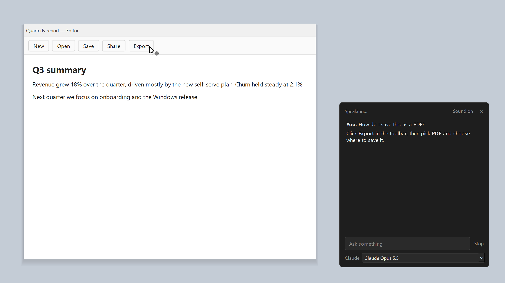

# Fizzy

An AI helper that sits beside your cursor on Windows.

Ask by voice or text. Fizzy looks at your screen (or the text you highlighted), answers out loud, and points at what you asked about.



## Features

- Voice, typing, or an optional "Fizzy" wake word
- Screenshot or highlighted-text context
- Points at buttons via UI Automation, OCR, or the AI
- Step-by-step guidance ("next", "repeat")
- Skips password, banking, and sign-in windows

Works with Claude, OpenAI, ChatGPT, Gemini, GitHub Copilot, Ollama, and LM Studio. Keys are stored in Windows Credential Manager.

## Quick start

Requires Windows 10 (2004+) or 11 and Python 3.11+.

```powershell
python -m venv .venv
.venv\Scripts\activate
pip install -r requirements.txt
python -m fizzy
```

| Shortcut | Action |
|---|---|
| `Ctrl+Alt+Space` | Talk |
| `Ctrl+Alt+T` | Type |
| `Esc` | Stop / close |

Settings live in the tray menu and `%LOCALAPPDATA%\Fizzy\settings.json`. Override any one with `FIZZY_<SETTING>`.

## Sign in with ChatGPT

Use your ChatGPT plan instead of an API key.

1. **Tray → Keys and sign-in… → ChatGPT → Sign in**
2. Approve in the browser window that opens
3. **Tray → AI → ChatGPT**

The token is stored in Windows Credential Manager and refreshes on its own. Sign out from the same dialog.

## Install

Download `Fizzy-Setup-<version>.exe` from [Releases](https://github.com/Owask/Fizzy/releases). No admin rights needed.

## Tests

```powershell
python -m pytest
```

## License

[MIT](LICENSE)
